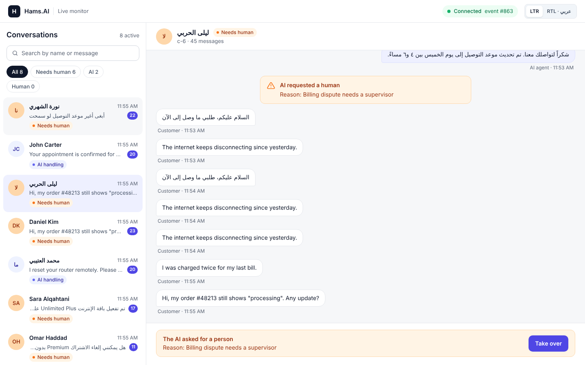
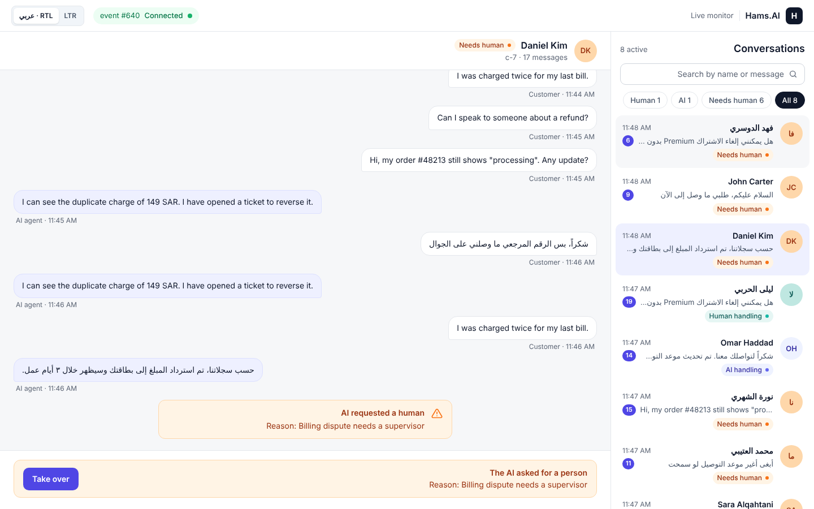

# Hams.AI · Live conversation monitor

This is a screen for a supervisor in a contact center. An AI agent talks to customers, and the supervisor watches.

- **Left side:** all conversations. Each one shows the customer's name, status, last message and number of unread messages.
- **Right side:** the messages of the open conversation. The AI's reply appears word by word.
- **When the AI asks for help,** the supervisor clicks **Take over** and replies to the customer.

Built with React 19, TypeScript (strict mode), Vite, TanStack Query, Zustand, react-virtuoso and Tailwind CSS.



## How to run it

You need **Node 22.12 or newer**. The mock server alone also works on Node 18.

```bash
npm install
npm run mock      # terminal 1: starts the mock server on http://localhost:4000
npm run dev       # terminal 2: open the link that Vite prints
```

Other commands:

| Command | What it does |
|---|---|
| `npm test` | Runs the 13 tests |
| `npm run typecheck` | Checks all TypeScript types |
| `npm run build` | Checks the types, then builds the app into `dist/` |

- **Different server address:** if the mock runs somewhere else, start the app with `VITE_API_URL=http://localhost:5000 npm run dev`.
- **After restarting the mock:** reload the page.
- **If the mock isn't running,** the list shows "Could not reach the server…" with a **Retry** button. Start the mock, then click Retry.

## Folders

```
mock-server.mjs            the mock server from the brief (not changed)
src/
  api/                     talking to the server: types, fetch, TanStack Query hooks
  live/
    reducer.ts             the main logic: takes the current state and one event, returns the new state
    store.ts               the Zustand store that holds that state
    sseClient.ts           opens the live connection and reconnects when it drops
    useEventStream.ts      loads the first data, starts the live connection, reloads if something is missing
  features/
    conversations/         the list on the left
    thread/                the open conversation on the right
  components/              small shared parts: top bar, connection status, status badge, avatar
  utils/format.ts          small helpers: initials and time format
  styles/tokens.css        colours and fonts from the design
tests/
  reducer.test.ts          11 tests for the event logic
  sseClient.test.ts        2 tests for reconnecting
```

## Server data vs live data

The app keeps data in two places.

**1. TanStack Query: data loaded from the server.**
- This covers the conversation list, the messages of a conversation, **Take over**, and sending a reply.
- TanStack Query is good at loading data, loading and error states, and requests that change data.

**2. Zustand: everything that changes live.**
- This covers everything the live stream changes, plus screen state: the open conversation, the connection status, and left-to-right or right-to-left.
- The live stream sends many small updates every second. With Zustand, each part of the screen reads only the small piece it needs. So when one message changes, only that message is drawn again.

**How they work together:** data from TanStack Query fills the Zustand store **once**. After that, the live stream keeps the store up to date. Live events never go into TanStack Query, because that would copy big lists for every single word.

**Where the logic lives:** all the live logic is in `reducer.ts`, as simple functions: "current state + event → new state". The store's actions just call these functions. This makes the hardest part easy to test, with no React and no server needed.

## How the app stays correct when the connection drops

The app gets live updates through one connection to the server that stays open all the time (`GET /events`). The mock cuts this connection every 20–40 seconds. The app then opens a new connection by itself: this is what "reconnecting" means, and there is no button for it. When the app reconnects, the mock sends the last 3 events again on purpose. Four rules keep the screen correct.

**1. Every event has a number, and we remember the last one we used.**
Event numbers go up by 1 each time. We store the last number we used as `cursor`.

| The new event's number is… | What we do |
|---|---|
| the same as or lower than `cursor` | Ignore it: we already have it. This handles the 3 repeated events. |
| exactly `cursor + 1` | Use it, and move `cursor` forward. |
| higher than `cursor + 1` | An event is missing. Stop and reload all data. |
| much lower than `cursor` | The server was restarted and started counting again. Reload all data. |

**2. We reconnect ourselves** (`sseClient.ts`).
- **What happens on a drop:** we close the old connection and open a new one with `?since=<cursor>`, so the server sends everything after the last event we used.
- **Why not the browser's automatic reconnect:** it keeps using the first address, with the old `since`. The mock reads that old `since` first, so it would resend events from the very start every time.
- **The waits between tries:** 0.5 s, 1 s, 2 s, 4 s, then 5 s each time.
- **What you see:** the pill in the top bar.
  - When the connection is cut, it shows **Reconnecting…** for about half a second.
  - Then it shows a green **Reconnected** for 3 seconds, because half a second is too quick to notice.
  - Then it goes back to **Connected**.
  - After 5 failed tries it shows **Offline**, but the app keeps trying.

**3. Opening a conversation never loses or repeats a word.**
1. When you open a conversation, we start **holding back** its live events, and note the current `cursor` as `listeningFrom`.
2. We load its messages. `listeningFrom` is part of the request's key, so we always get fresh messages, never an old saved copy.
3. The loaded messages come with `lastEventId`: every event up to that number is already included. So from the events we held back, we skip those up to that number and apply the rest.
4. **Example:** an AI reply was half finished when you opened it ("Your order…"). It continues correctly with no word missing or doubled.

**4. AI replies are built from their words.**
An AI reply arrives as "start", then one event per word, then "end". There is no single event with the full text. So the conversation list joins the words itself, even for conversations you never opened.

## Hand-off and replies

**The AI asks for help.**
- An orange card with the reason appears in the conversation, and the status changes to **Needs human**.
- Above the reply box, the reason is shown again with a **Take over** button.
- If nobody takes over within 3 minutes, the mock gives the conversation back to the AI. The button disappears, but the card stays in the history.

**Take over.**
- The status changes to **Human handling** and the reply box opens.
- We also read the new status from the server's answer, not only from the live stream. That's because the mock sends no live event when the conversation is already with a human.

**Sending a reply.**
- **It shows at once** as **Sending…**, with its own id (`clientMessageId`).
- **The server confirms it in two ways:** the answer to our request, and a live event. Both go through the same function and match on the id. So the reply is marked **Sent ✓** once, whichever comes first, and is never shown twice.
- **If the server refuses it** (the mock does this about 1 time in 5), the reply turns red with **Not sent**, the server's reason, and **Retry** / **Discard** buttons.
- **Retry** sends it again with the same id, so a successful retry replaces the red bubble instead of adding a new one.

**One detail in the code.**
- With TanStack Query, code you pass to `mutate()` only runs for the **last** request. If you send several replies quickly, the earlier ones would never be marked **Sent** or **Not sent**.
- So the store updates are in the `useMutation` options instead. Those run for **every** request.

## Speed with 5,000 messages

- **Only visible messages are drawn.** react-virtuoso shows only the messages on screen (about 10 of the 5,000 in conversation `c-1`).
- **Each message re-draws itself.** Each message and each list row gets only an id and reads its own data from the store. So when a new word arrives, **only that one message is drawn again**, plus its row in the list.
- **Measured in Chrome:** scrolling through `c-1` stayed at 60 frames per second (slowest frame 16.8 ms).

## Arabic and English

- **The LTR / RTL button** flips the whole layout and remembers your choice.
- **The CSS uses "start" and "end" instead of "left" and "right"** (for example `ps-4`, `me-2`, `text-start`). So everything mirrors by itself.
- **Each message and name uses `dir="auto"`,** so Arabic reads right to left and English reads left to right, even when they're mixed.
- **Short labels** such as "10:48 AM" or "Reason: …" are wrapped in `<bdi>`, so their words and punctuation stay in the right order in RTL.
- **Text colours** pass the WCAG AA contrast check (4.5:1 or better).



## Tests

`npm test` runs 13 tests.

**`tests/reducer.test.ts`** (11 tests):

1. Words of an AI reply are joined in the right order.
2. Events sent again after a reconnect are ignored.
3. A missing event makes the app reload its data.
4. A hand-off adds the reason card and changes the status.
5. Loaded messages and held-back live events are joined without gaps or repeats.
6. A reply is shown once, whether the live event or the server's answer comes first.
7. A refused reply turns red, and Retry and Discard work.
8. Unread counts only customer messages, and only for conversations that aren't open.
9. The list shows the AI's full reply even if that conversation was never opened.
10. The hand-off card stays when the conversation goes back to the AI.
11. A server restart makes the app reload its data.

**`tests/sseClient.test.ts`** (2 tests): uses a fake connection.
- A reconnect asks for events after the **latest** number, not the first one, and the pill shows **Reconnected** for 3 seconds.
- The waits between tries, and the **Offline** state.

**Checked against the real mock server** for 5 minutes:
- **In the browser:** the connection dropped 11 times. The event number only went up (#43 → #863), and the open conversation matched the server exactly.
- **The event logic on its own:** with the same 11 drops, it ignored 36 repeated events, and **all 5,213 messages** in six conversations matched the server, with **0 mistakes**.

## What I skipped (known limits)

- **Optional extras:** keyboard shortcuts, a live demo link and a screen recording.
- **A short blank moment when opening a conversation:** the message area is empty for under half a second while the list measures the messages, and the "Jump to latest" button flashes.
- **Loading the page during an AI reply:** that reply's text may not show in the left list until the next message. The conversation itself is correct.
- **Hand-offs from before the page loaded:** they show "Reason: not available", because the REST API doesn't return past hand-off events. Only hand-offs that happen while the app is open show their reason.
- **Order of quick replies:** the mock saves replies after a random wait (0.3–0.9 s). After a page reload they appear in the order the server saved them, which can differ from the order they were sent. A retried reply moves to the end.
- **Failed replies after a reload:** they are kept only in memory, so a page reload removes them.
- **Unread counts:** the mock has no way to mark messages as read, so opening a conversation resets its count in the app only.
- **Message count:** the count in the conversation header also counts hand-off cards.
- **Date lines:** none, because all of the mock's messages are from today.
- **Take over button:** there is one, above the reply box next to the reason, and not a second one in the header. One button means one place to show its loading and error states.

## What I would improve with more time

1. **Send replies one at a time,** so the customer always sees them in the order they were written.
2. **Group many words into one screen update** when lots of replies stream at the same time.
3. **Add browser tests** (Playwright) with a fake server that can cut the connection, skip an event, or restart on demand.
4. **Keyboard and screen reader support:** arrow keys to move through the list, Enter to open, a shortcut for Take over, and new messages read aloud.
5. **Keep failed replies after a page reload,** and show which supervisor took over when there are several.
6. **Arabic text for the buttons and labels in RTL mode,** not only a mirrored layout.

## Notes about the mock server

I didn't change `mock-server.mjs`. I noticed these things while building against it:

1. **It reads `since` in the address before the `Last-Event-ID` header.** The browser's automatic reconnect keeps the old address, so the mock resends old events every time. That's why the app reconnects itself.
2. **It keeps every event forever,** so each reconnect looks through all events since the server started.
3. **Unread counts can never go down on the server.** There's no endpoint for it, so reloading brings back counts the app had cleared.
4. **Conversation `c-7` starts as "Needs human" without a hand-off event,** so there is no reason to show for it.
5. **Take over also works while the AI is handling the conversation,** not only when it asks for help.
6. **The server doesn't check `clientMessageId` for repeats.** If a reply was saved but the answer got lost and the app retried, the reply would be saved twice.
7. **Restarting the server starts the event numbers from 0 again.** The app notices this (an event number far below its cursor) and reloads its data.
# hams-ai-supervisor
